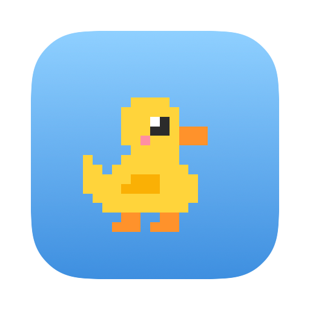
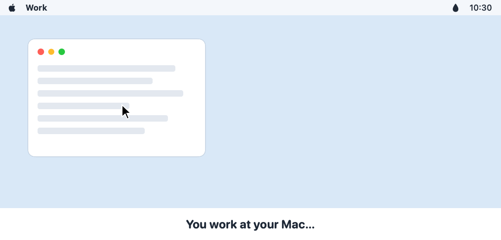
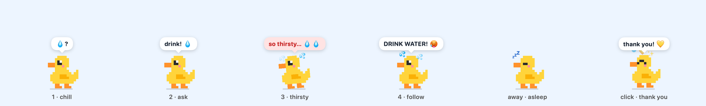

<div align="center">
  
  <h1>Thirsty Duck</h1>
  <p><b>A tiny pixel duck that reminds you to drink water.</b><br>
  It walks onto your screen, gets more and more thirsty, and leaves when you drink.</p>

  <a href="LICENSE"></a>
  
  
  

  <br><br>
  
</div>

## Features

- **Native and light.** A Swift menu bar app with no dependencies, no network, and no permissions. It uses almost no CPU while it waits, and it draws a new frame only when the duck changes.
- **Gets more thirsty.** Four levels, five minutes apart. At level 4 it follows your cursor until you click it.
- **Counts only real computer time.** The clock stops when you are away, and a long break starts it again from zero.
- **Stays out of your way.** Only the duck takes clicks; everything around it works as normal. No Dock icon, no keyboard focus, no sound.

## The stages



| Stage | When | What the duck does |
|---|---|---|
| 1 · Chill | After 30 minutes of computer use | Walks in from the right, sits on the bottom edge of the screen, and does small tricks: blink, hop, wiggle, peck, a short stroll. Sometimes asks `💧?` |
| 2 · Ask | 5 minutes later | Walks a little toward the middle and says `drink! 💧` |
| 3 · Thirsty | 10 minutes later | Sweats and shakes: `so thirsty… 💧💧` |
| 4 · Follow | 15 minutes later | Follows your cursor across screens: `DRINK WATER! 🥵`. It waits when you move toward it, so you can click it. |
| Asleep | 5 minutes with no mouse or keyboard input | Naps where it is. The clock and the thirst stop until you come back. |
| Thank you | You click the duck | Happy hop, `thank you! 💛`, and it walks off. The clock starts again. |

By default the duck comes every day between 08:00 and 23:00; change it in **Active hours**. A break of 30 minutes or more (idle time and Mac sleep together) starts the clock again from zero.

## Install

There is no download yet. The app is not signed with an Apple Developer ID, so macOS would block a downloaded copy. Build it yourself; it takes a few seconds and needs only the Swift Command Line Tools (`xcode-select --install`), not Xcode.

```sh
git clone https://github.com/oskarsonc/thirsty-duck.git
cd thirsty-duck
./build.sh
mkdir -p ~/Applications
cp -R "build/Thirsty Duck.app" ~/Applications/
open ~/Applications/"Thirsty Duck.app"
```

Or paste this into your coding agent:

> Clone https://github.com/oskarsonc/thirsty-duck, run `./build.sh`, copy `build/Thirsty Duck.app` to `~/Applications` (create the folder if needed), and open it.

A water drop appears in the menu bar. Select **Open at login** there if you want the duck every day.

The app is set to macOS 14 or later, but it is tested only on macOS 27 on Apple Silicon.

## Menu

| Item | What it does |
|---|---|
| *Next duck in 12 min* | The first line shows when the next duck comes, that the duck is here, or *Off until 08:00*. |
| **Call the duck now** | Brings the duck at once. Good for a first look. |
| **Remind every** | 20, 30, 45 or 60 minutes of computer use. |
| **Active hours** | When the duck may come: **Starts at** 06:00–12:00, **Ends at** 16:00–24:00, and **Weekends** on or off. |
| **Show on** | The screen the duck comes in on, if you have more than one. It is the main screen by default. |
| **Open at login** | Starts the duck when you log in. |
| **Quit** | |

To change the level times or other numbers, edit `Sources/DuckCore/Timings.swift` and run `./build.sh` again.

## FAQ

**Does it track me?** No. It reads only how many seconds ago you last used the mouse or keyboard, and where the cursor is. It saves nothing except your menu choices, and it never uses the network.

**Why does the duck sleep?** After 5 minutes with no input, the app takes it that you are away. The clock stops, so you are not punished for a meeting or a coffee.

**How much CPU does it use?** About 0% while hidden, about 1% while it sits, and a few percent while it walks. It ticks only as often as the duck needs: 30 times a second while it moves, 10 while it sits, 2 while it sleeps, and once a second while hidden.

## Development

```sh
swift test                              # DuckCore tests (swift-testing)
DUCK_FAST=1 "build/Thirsty Duck.app/Contents/MacOS/ThirstyDuck"   # demo times
./scripts/render-docs.sh                # renders the README pictures and the app icon
```

- **Fast mode** (`DUCK_FAST=1`): the duck comes after 10 s, gets more thirsty every 15 s, sleeps after 10 s with no input, and a 30 s break starts the clock again. Work hours are ignored. Add `DUCK_DEBUG=1` to print each phase and tick rate change to stderr.
- If `swift test` fails with "plugin for module 'TestingMacros' not found", load the plugin by path:
  ```sh
  swift test -Xswiftc -load-plugin-library \
    -Xswiftc /Library/Developer/CommandLineTools/usr/lib/swift/host/plugins/testing/libTestingMacros.dylib
  ```
- The pictures in `docs/` and `Resources/AppIcon.icns` are drawn off screen from the app's own `DuckView`, so they always match the app.

### Where things are

- `Sources/DuckCore/` is the pure logic, tested with a fake clock. `Duck.swift` is the state machine; every change goes through `Duck.step`. `Timings.swift` has all times, hours, speeds and distances. `Frame.swift` turns the duck into the picture to draw and the tick rate. `Layout.swift` has the panel geometry and the click regions.
- `Sources/ThirstyDuck/` is the app. It reads the system, sends ticks and clicks to the duck, and draws it. `Settings.swift` keeps the menu choices.
- `SPEC.md` is the full behavior spec.

## License

MIT. See [LICENSE](LICENSE).
